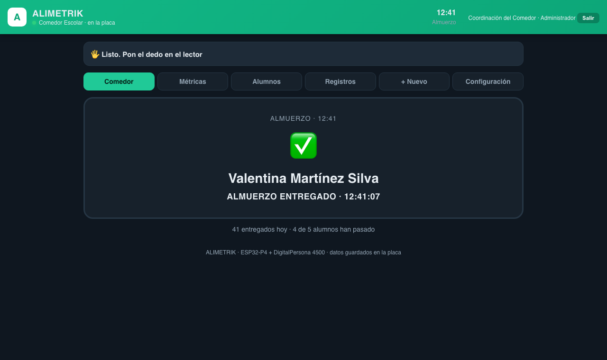

# ALIMETRIK — Comedor escolar con huella dactilar

Sistema que controla la entrega de raciones en un comedor escolar identificando a cada
estudiante por su **huella dactilar**. Funciona **100 % autónomo** en una placa ESP32-P4:
lee la huella, identifica a la persona, evita que reciba dos veces el mismo servicio y
guarda todo en su propia memoria. Se administra desde el celular por una red WiFi propia,
sin internet y sin computador.



## Qué hace

- **Identificación 1:N** por huella: el estudiante solo pone el dedo; no necesita carné.
- **Anti-duplicado**: una ración por servicio y por día; los intentos repetidos quedan registrados.
- **Servicios y horarios configurables** desde la web (desayuno, almuerzo, refrigerio…).
- **Kiosco de entrega** con tarjeta grande y señal sonora (verde entregado, ámbar ya recibió, rojo denegado).
- **Métricas**: raciones por servicio, duplicados bloqueados, cobertura del programa.
- **Inicio de sesión** para los encargados, con roles de administrador y operador.
- **Protección de datos biométricos** conforme a la Ley 1581 de 2012: no se registra a nadie
  sin autorización previa, expresa e informada, y se puede revocar en cualquier momento.
- **Datos persistentes**: sobreviven a cortes de energía.

## Hardware

| Pieza | Modelo |
|---|---|
| Placa | Guition ESP32-P4 (chip rev. v1.3, 32 MB PSRAM, 16 MB flash) con radio ESP32-C6 |
| Lector de huellas | DigitalPersona U.are.U 4500, conectado al puerto USB-OTG de la placa |
| Acceso | Celular o computador conectado a la red WiFi `ALIMETRIK` |

## Estructura del repositorio

```
test-driver-4500/            FIRMWARE (ESP-IDF) — arquitectura MVC
  main/
    modelos/                   datos y reglas de negocio (alumnos, huellas, registros,
                               usuarios, servicios, almacenamiento en flash)
    vistas/                    páginas web (sistema, inicio de sesión, términos) y JSON
    controladores/             lector de huellas, red WiFi, servidor web, sesiones
  components/nbis/             extracción de minucias (NIST) + comparador propio
  parches/                     parche obligatorio de esp_hosted (ver "Compilar")
ALIMETRIK-entrega/           ENTREGA ACADÉMICA
  manuales/                    manual de usuario, manual técnico, explicación del código
  base-de-datos/               modelo entidad-relación, esquema y base completa en MySQL
  capturas/                    pantallazos de la aplicación, phpMyAdmin y el código
  presentacion/                presentación del proyecto (PowerPoint y PDF)
  jira/                        gestión del proyecto en Jira y su paso a paso
presentacion/                generadores de los documentos (Node.js)
capturas/                    herramientas para generar las capturas (Python)
PROTOCOLO-4500.md            protocolo USB del lector, documentado
```

## Compilar y grabar

Requiere [ESP-IDF v5.5](https://docs.espressif.com/projects/esp-idf/) instalado.

```bash
cd test-driver-4500
source ~/esp/esp-idf/export.sh
idf.py reconfigure              # descarga los componentes (esp_hosted, esp_wifi_remote)
./parches/aplicar-parches.sh    # OBLIGATORIO: sin este parche la placa se reinicia en bucle
idf.py build
idf.py -p /dev/cu.usbserial-XXX -b 460800 flash
```

> **Por qué el parche:** el componente `esp_hosted` se auto-arranca antes que la aplicación
> y agota la memoria interna; la placa entra en un bucle de reinicios. El parche desactiva
> ese auto-arranque y el firmware lo inicia en el momento correcto.

Reflashear la aplicación **no borra los datos**: viven en una partición aparte (`almacen`).

## Primer uso

1. Encender la placa con el lector conectado.
2. Conectarse a la red WiFi **`ALIMETRIK`** y abrir **http://192.168.4.1**.
3. Ingresar con el usuario inicial `admin` / `admin123` y **cambiar la contraseña de inmediato**
   (Configuración → Mi cuenta).
4. Configurar los servicios y horarios, registrar a los estudiantes con su autorización y
   enrolar sus huellas (3 muestras por dedo).

El paso a paso completo está en el [manual de usuario](ALIMETRIK-entrega/manuales/MANUAL-DE-USUARIO.docx)
y la instalación en el [manual técnico](ALIMETRIK-entrega/manuales/MANUAL-TECNICO.docx).

## Base de datos

El sistema es embebido: guarda sus tablas como archivos binarios en la memoria flash de la
placa. El mismo modelo está disponible en MySQL/MariaDB para consulta y documentación:

- [Modelo entidad-relación](ALIMETRIK-entrega/base-de-datos/diagramas/modelo-entidad-relacion.png)
- [Esquema comentado](ALIMETRIK-entrega/base-de-datos/esquema-mysql.sql)
- [Base completa con datos de ejemplo](ALIMETRIK-entrega/base-de-datos/alimetrik-con-datos.sql)
  (importable en phpMyAdmin). Los nombres y documentos de ejemplo son ficticios.

## Créditos

- Extracción de minucias: **NBIS / MINDTCT** del NIST (dominio público).
- Protocolo del lector: basado en el driver `uru4000` de **libfprint** (LGPL-2.1).
- Comparador de huellas, almacenamiento, portal web y kiosco: desarrollo propio del proyecto.

Proyecto escolar — grado 11.
